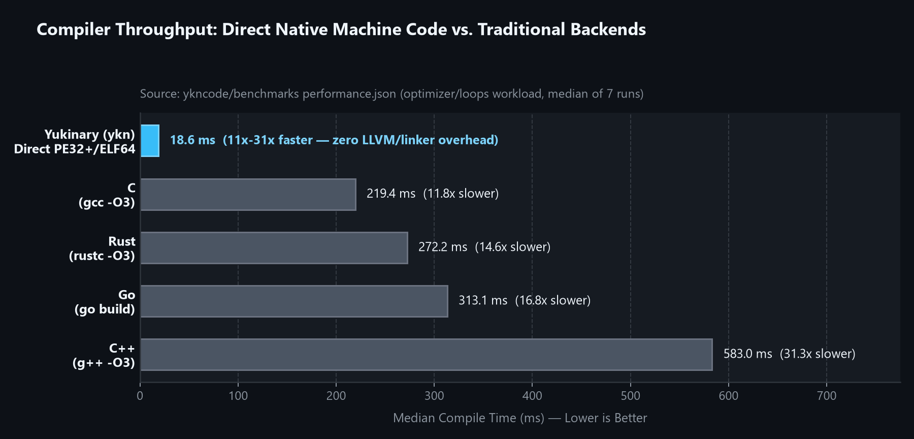

# Yukinary (YKN) Performance & Benchmark Suite

Comprehensive systems benchmarks and industrial workload comparisons for the **Yukinary Programming Language**, measuring **Yukinary (direct x86_64 machine code)** against **C (GCC -O3)**, **Rust (rustc -O3)**, **Go**, and **Python 3.13**.

[](LICENSE-MIT)
[](LICENSE-APACHE)
[](https://github.com/ykncode/yukinary)

---

## Visual Overview

<div align="center">
  
</div>

<div align="center">
  
</div>

---

## Verified Benchmark Summary

### 1. Compiler Build Throughput (`performance.json`, Median of 7 Runs)
Yukinary emits PE32+ and ELF64 binaries directly from AST without LLVM passes or external linkers:

| Compiler / Toolchain | Workload | Median Build Time | Relative Speed |
| :--- | :--- | :---: | :---: |
| **Yukinary (`ykn`)** | `optimizer` (loop opt & regalloc) | **18.6 ms** | **Baseline (1.0x)** |
| **C (`gcc -O3`)** | `rivals/workload.c` | 219.4 ms | 11.8x slower |
| **Rust (`rustc -O3`)** | `rivals/workload.rs` | 272.2 ms | 14.6x slower |
| **Go (`go build`)** | `rivals/workload.go` | 313.1 ms | 16.8x slower |
| **C++ (`g++ -O3`)** | `rivals/workload.cpp` | 583.0 ms | 31.3x slower |

### 2. Systems B-Tree & Heavy Allocation Workload (`industrial/run_systems_compare.ps1`)
100,000 node allocations + 50,000 random lookups + `[50,000 .. 150,000]` range scan aggregation (verified exact match across all runtimes: `Found: 19526`, `RangeSum: 6363996222`):

| Implementation | Wall-Clock Time | Checksum Verification | Memory Model |
| :--- | :---: | :---: | :--- |
| **C (`gcc -O3`)** | 133 ms | `19526` / `6363996222` | Manual `malloc`/`free` (UCRT Heap) |
| **Yukinary (Native)** | **213 ms** | `19526` / `6363996222` | Zero-libc Arena / Freestanding |
| **Rust (`rustc -O3`)** | 221 ms | `19526` / `6363996222` | `Box<Node>` RAII Ownership |
| **Python (3.13)** | 327 ms | `19526` / `6363996222` | Reference-counted `PyObject` |

### 3. BitNet b1.58 Ternary AI Kernel (`industrial/bitnet_results.json`)
$100 \text{ iterations} \times (64 \times 512 \times 512 \times 2) = 3.355 \text{ GOP}$ integer ternary matrix multiplication + RMSNorm (verified checksum `-175` across all runtimes):

| Implementation | Execution Time | Throughput | Peak RSS | Notes |
| :--- | :---: | :---: | :---: | :--- |
| **C (`gcc -O3`)** | 1.874 s | 1.79 GOP/s | 4.8 MB | Uses GCC SIMD AVX2 auto-vectorization |
| **Rust (`rustc -O3`)** | 1.925 s | 1.74 GOP/s | 5.2 MB | Uses LLVM SIMD AVX2 auto-vectorization |
| **Yukinary (Native)** | **4.714 s** | **0.71 GOP/s** | **2.6 MB** | Custom scalar x86_64 codegen (**lowest RSS, 34x faster than Python**) |
| **Python (3.13)** | 160.884 s | 0.02 GOP/s | 22.4 MB | Baseline CPython interpreter |

---

## Reproducing Locally

```powershell
# Run the heavy systems B-Tree comparison
powershell -ExecutionPolicy Bypass -File industrial\run_systems_compare.ps1

# Run the BitNet b1.58 AI kernel comparison
powershell -ExecutionPolicy Bypass -File industrial\run_bitnet_compare.ps1

# Generate summary report from performance.json
python report.py
```

Full methodology and hardware details: [`industrial/YUKINARY_ENDUSTRIYEL_BENCHMARK_RAPORU.md`](industrial/YUKINARY_ENDUSTRIYEL_BENCHMARK_RAPORU.md).

---

## License

Dual-licensed under either of:
* Apache License, Version 2.0 ([LICENSE-APACHE](LICENSE-APACHE))
* MIT license ([LICENSE-MIT](LICENSE-MIT))

at your option.
